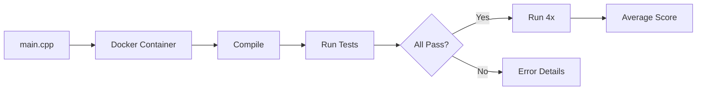

ALE-Bench provides AtCoder Heuristic Contest problems for evaluating algorithmic optimization agents. Kapso achieved **#1 on ALE-Bench**.

<Frame caption="Elo rating per AtCoder Heuristic Contest problem, against ALE Agent">
  
</Frame>

The ratings are from one Kapso run per problem by Leeroo, each under the problem's own time budget:
the campaign scored by the official scorer on the public cases, the delivered candidate judged once
on the private cases, from which the benchmark's library estimates the rating; ALE Agent's
per-problem ratings are the benchmark's published ones. One run per problem is one observation, so
no spread is reported, and these runs predate Kapso's launch record, so no run date is kept with
them.

## Usage

```bash
# List available problems
PYTHONPATH=. python -m benchmarks.ale.runner --list

# List lite benchmark problems
PYTHONPATH=. python -m benchmarks.ale.runner --lite

# Solve a problem
PYTHONPATH=. python -m benchmarks.ale.runner -p ahc039

# With options
PYTHONPATH=. python -m benchmarks.ale.runner \
    -p ahc039 \
    -i 30 \
    -d codex
```

## CLI options

| Option | Description | Default |
|--------|-------------|---------|
| `-p, --problem` | Problem ID (e.g., `ahc039`) | Required |
| `-i, --iterations` | `Budget.experiments` | the config's `budget.experiments` |
| `--time-budget-hours` | `Budget.minutes`, in hours | the config's `budget.minutes` (unbounded) |
| `-d, --coding-agent` | The host every role without a `cli` of its own runs on | `codex`, the override file's `host` |
| `--harness` | A harness reference | the bundled `competitive-programming` |
| `--experience` | Comma-separated experience sources to serve | none |
| `--workspace` / `--resume` | The campaign directory / continue the campaign in it | a fresh directory |
| `--final-eval-only` | No campaign: the final report (the private cases, the rank, the performance) on the solution the `--workspace` campaign already holds; refused without `--workspace` | - |
| `--list` / `--lite` | List problems | - |

## Scored problems

The reported result covers these ten problems; `--lite` lists them and `--list` every ALE-Bench problem:

`ahc008`, `ahc011`, `ahc015`, `ahc016`, `ahc024`, `ahc025`, `ahc026`, `ahc027`, `ahc039`, `ahc046`

<Note>
The runner launches `build()` with the bundled `competitive-programming` harness. The
provided grader, registered by the evaluation maintainer, judges each candidate's `main.cpp`
through the ALE-Bench Docker judge on the public cases: the score of record. The candidates
run the same grader as their scorer; the private cases and the rating are computed once,
after the campaign, on the delivered candidate.
</Note>

## Output structure

The agent generates:

```text
experiment_workspace/{uuid}/
├── main.cpp          # C++ solution
├── pre_run.cpp       # Optional precomputation (max 1 min)
└── sessions/         # Experiment branches
```

## Evaluation



The evaluation process works as follows:

1. **Code Submission**: the `main.cpp` at the repository root of the candidate's branch
2. **Docker Evaluation**: the provided grader sends it to `ale_bench`'s judge, which compiles and runs it in an isolated Docker container
3. **Test Execution**: the solution runs against every public case with the problem's limits
4. **Validation**: a case not `ACCEPTED`, or scored zero, fails the submission, which takes the floor score
5. **Score Stabilization**: the full evaluation runs the judge **4 times** and averages the totals (the `benchmark.runs` key of `config.yaml`); the candidates' own scorer run writes the per-seed results file the harness's finish hook reads
6. **Final Ranking**: the runner judges the delivered candidate once on the private cases and estimates the rank and the performance against the contest's standings

## Code requirements

Generated C++ must:
- Be time-aware (the limit minus input, output and a margin)
- Handle all input constraints
- Use efficient algorithms and data structures
- Include compiler optimization pragmas if helpful

## Domain knowledge

The bundled `competitive-programming` harness carries the discipline: the heuristic
patterns (simulated annealing, beam and random search, random simulation, colony methods,
exact methods), performance under a time limit, the scorer procedure and its finish hook,
and the score auditor that names the category of cases a solution loses on.

## Related

<CardGroup cols={2}>
  <Card title="Installation" icon="download" href="/docs/installation#optional-benchmarks">
    Installing the harness
  </Card>
  <Card title="IOAI 2026" icon="trophy" href="/docs/benchmarks/ioai-2026">
    The olympiad track
  </Card>
</CardGroup>

Related pages: [Installation](/docs/installation#optional-benchmarks) · [IOAI 2026](/docs/benchmarks/ioai-2026) · [Competitive programming](/docs/harnesses/bundled/competitive-programming)

Kapso is an open-source framework by [Leeroo](https://leeroo.com) that builds software toward measurable goals through experiment campaigns. Source code: [github.com/Leeroo-AI/kapso](https://github.com/Leeroo-AI/kapso) · Install: `pip install leeroo-kapso` · Every page as plain text: [llms.txt](https://docs.leeroo.com/llms.txt).
