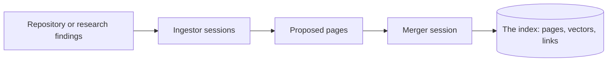

Loading never creates. `kapso experience add` makes the sources that must exist before they can be loaded: your bank, the hosted gate's key, an index. A bank by path or git reference needs no add; it is read where it is ([Share a bank](/docs/experience/share)).

## Your bank

```bash
kapso experience add mine
```

```text
created your bank at /home/me/.kapso/bank.git (empty; learn() fills it, --experience mine serves it)
```

The bank is a bare git repository at `learning.bank.local_path`, `~/.kapso/bank.git` by default: one per user, outside any project, so a campaign's data directory never sweeps it up. A first `learn()` creates it too. What goes in it is on [The lesson bank](/docs/learn/what-learn-produces); every lesson lands as one reviewed commit, tagged, which is what lets a campaign pin the exact bank it was served.

## The hosted gate

```bash
kapso experience add leeroopedia
```

[Leeroopedia](https://leeroopedia.com) is the hosted knowledge base of ML and AI frameworks: nothing to install, one key. Sign up at [app.leeroopedia.com](https://app.leeroopedia.com/dashboard), put `LEEROOPEDIA_API_KEY=kpsk_...` in `.env` beside where you run, and `add leeroopedia` confirms the key is set and sends the gate one MCP `initialize` with it, reporting the server's name; `--experience leeroopedia` then mounts the gate in the ideation and implementation sessions, at the address and timeout of the config the source was loaded with. Without the key, or with an empty one, the add says where the key goes and nothing else happens; a key the gate refuses stops the add with the HTTP status. The gate is an experience source, not a doctor row: a build needs it only when it loads it.

## An index: a repository or a question

```bash
kapso experience add --repo https://github.com/org/x --name org-x
kapso experience add --research "QLoRA memory optimizations for 7B models on one GPU" --name qlora
```

```python
kapso.add_experience(repo="https://github.com/org/x", name="org-x")
kapso.add_experience(research="QLoRA memory optimizations for 7B models on one GPU", name="qlora")
kapso.load_experience("org-x")
```

An index is a corpus turned into pages a session can search. `--repo` clones the repository and reads it; `--research` runs one read-only coding-agent session with live web search (the `research` role of the config's `inference` block, Codex with its native search as shipped) that gathers what the question asks for in the modes and at the depth the config's `experience.research_modes` and `experience.research_depth` name (ideas and implementation references, deep, as shipped), then reads those. Either way the pages land under `experience.indexes` (`~/.kapso/experience/indexes/<name>/wiki/`), their vectors and links in the index's own namespace of the graph stores, and `index.json` beside them records the index at its id. The name is `[a-z0-9][a-z0-9-]*`; `mine` and `leeroopedia` are reserved. An index is never written again after this: a name that exists is refused, and `kapso experience remove <name>` clears it (its namespace, its pages, its record) before an add under the same name.

Ingesting takes minutes to hours, with the material, not with the question; it is a foreground command that writes a status file, so follow it with `kapso watch` from another shell:

```text
$ kapso experience add --repo https://github.com/org/x --name org-x
status: learning/status/experience-20261025T141501.json
...
Experience added: org-x (index 7c2d9e1f0a3b, 84 pages); `org-x` loads it
```

The status file lives under `learning.status_dir` with the phase (`ingest`, `merge`), the sources done and the pages extracted so far.

### What it needs

`kapso doctor experience` reports it before anything runs, and the add runs the same check:

| Requirement | Why |
|---|---|
| the ingestor's and the merger's coding-agent CLI, logged in (`learner.ingestor`, `.merger`; `claude_code` as shipped) | every phase of the pipeline is one session |
| `git` | a repository is cloned |
| `OPENAI_API_KEY` in `.env` | the pages are embedded (OpenAI as shipped; Vertex AI with `embedding_provider: vertex`) |
| Weaviate and Neo4j | the index's namespace: vectors and links |
| with `--research`, the `research` role's CLI | the web-search session |
| with `learner.ingestor.publish_workflows`, `GH_TOKEN` | the extracted workflows are published as repositories |

The stores run in Docker; from a source checkout `bash scripts/start_infra.sh` starts Weaviate on `localhost:8080` and Neo4j on `localhost:7687` (`neo4j` / `password`), `bash scripts/stop_infra.sh` stops them, `--volumes` wipes the data. The endpoints, the embedding provider and model are `knowledge_search.params` in the [config](/docs/reference/configuration#knowledge_search); the Neo4j password is read from `NEO4J_PASSWORD`. An index records its endpoints and embedding model in `index.json`, so a build that loads it reaches the stores it was built on and embeds queries the same way.

### How an index is built

Two stages turn a source into pages a session can search: ingestors extract structured pages from the source, then the merger folds them into the index.



**Ingesting a repository** runs a sequence of sessions over a clone: a repository map first (structure and a reading of each file), then workflows anchored on the README and examples, the implementations and principles they rest on, the environments and heuristics around them, an audit of the links, and a review of what the workflows left out. **Ingesting research** plans the pages for the ideas and implementation references the search returned, writes them, and audits them. Every page is one of four kinds, linked top down: a *principle* (the theory) is implemented by one or more *implementations* (the code), which may require an *environment* and use *heuristics*. Each session holds five file tools (Read, Write, Edit, Glob, Grep) and, for the merge, the index's own tools, and nothing else: a repository's code or README cannot make a session run a command, reach the network or delegate.

**Merging** is one session over the proposed pages, sub-graph by sub-graph: it searches the index for a page of the same kind to merge each root into, decides for the children under that decision, writes bottom up (environments and heuristics first, principles last), and audits that every page and link it planned exists. Into a fresh index, every page is new and the index is built from them; into an existing one, pages are merged, edges only ever added. What the run extracted and merged is in the status file and the add's last line.

A run stages its clone, phase reports and pages under `<index>/wiki/_staging/` and marks each finished phase, so a run that stopped, on a failed phase or a killed process, continues from the first unfinished phase when the same source is added again under the same name before the index was written; `learner.ingestor.cleanup` removes the clone when a run completes and `cleanup_staging` the whole directory. A phase that fails stops the run with its reason: an add never returns a partial index as a success.

### Searching it

A build that loads an index mounts two tools in its ideation and implementation sessions, `wiki_idea_search` and `wiki_code_search`: a query is embedded, the nearest pages are retrieved from Weaviate, reranked when `use_llm_reranker` is on, and enriched with their linked pages from Neo4j. The `knowledge_search.preset` names how much of that work happens (`DEFAULT`, `FAST`, `RERANK_ONLY`). The intro tells the session the corpus is there and how it is searched; the session decides when to ask.

## Related

<CardGroup cols={2}>
  <Card title="Use experience on a build" icon="play" href="/docs/experience/use">
    Load what you added; read what the campaign recorded
  </Card>
  <Card title="Share a bank" icon="share-nodes" href="/docs/experience/share">
    Attach a remote to your bank; read another team's
  </Card>
  <Card title="Installation" icon="download" href="/docs/installation">
    The CLIs, the keys, and kapso doctor
  </Card>
  <Card title="Experience reference" icon="book" href="/docs/reference/experience">
    The index record, the config keys, the namespaces
  </Card>
</CardGroup>

Related pages: [What experience is](/docs/experience) · [Use experience on a build](/docs/experience/use) · [Share a bank](/docs/experience/share) · [Experience reference](/docs/reference/experience) · [Configuration](/docs/reference/configuration#knowledge_search)

Kapso is an open-source framework by [Leeroo](https://leeroo.com) that builds software toward measurable goals through experiment campaigns. Source code: [github.com/Leeroo-AI/kapso](https://github.com/Leeroo-AI/kapso) · Install: `pip install leeroo-kapso` · Every page as plain text: [llms.txt](https://docs.leeroo.com/llms.txt).
