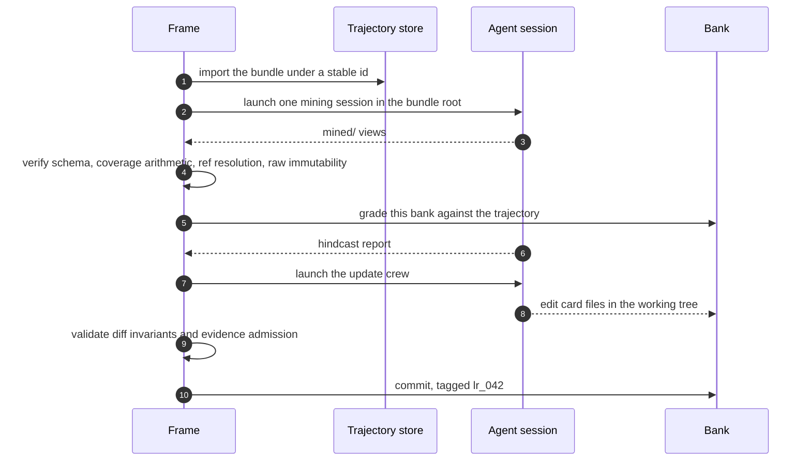
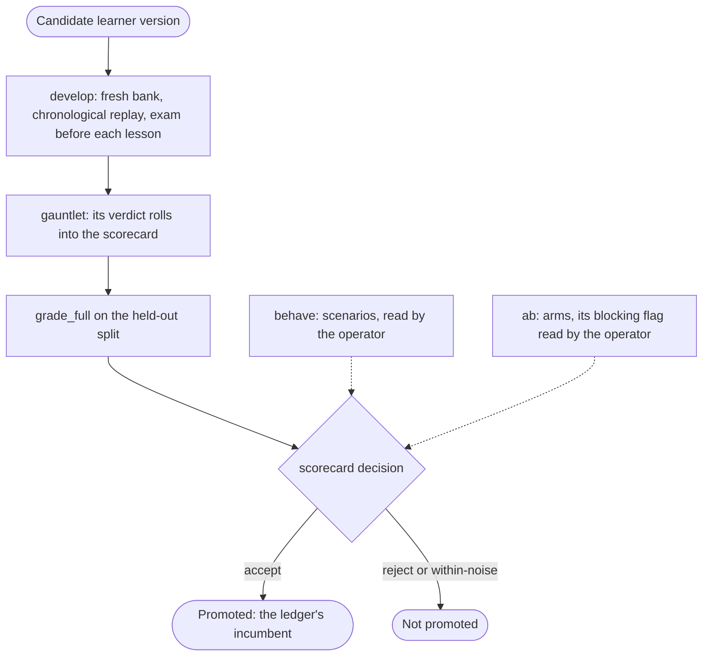

[What learn produces](/docs/learn/what-learn-produces) is the user's side: a campaign in, cards out. This page is for people working on the learning system itself. The stages run one at a time, the graders' reports and arithmetic are inspectable, the bank's invariants are enforced by a frame, and a new version of the learner is itself the artifact under test.

```bash
kapso learn dev import --archive ./campaign.tgz
kapso learn dev mine --all
kapso learn dev grade --bank ./bank --bank-head lr_042 --trajectory <id>
kapso learn dev update --learner-version crew_v4 --batch-manifest batch.yaml
kapso learn dev ingest --trajectory <id> --learner-version crew_v4      # mine, exam, lesson: the operating chain
```

## The frame does the mechanics, agents do the judgment

Every stage has the same shape: a **frame** stages the work, launches **one** agent session, and mechanically verifies what came back. The frame never orchestrates the agents and never judges the content; a score an agent writes enters an aggregate only after the frame has held it to its evidence, and every aggregate, corridor, delta and calibration figure is the frame's arithmetic. When verification fails, the frame allows a bounded number of repair rounds (each crew's `repair_rounds`: shipped as 1 for mining, 3 for the update crew, 5 for the graders) and then fails loud.



## The four stages

**Import.** A bundle enters the trajectory store under `<task>/<YYYYMMDDTHHMMSS>_<lane>`, unpacked, one object per file. The manifest `trajectory.yaml` is written last, as the commit marker: a bundle whose manifest is present arrived completely. Reads go through three doors, `manifest`, `resolve` and `open_ref`, which is what lets a card cite a line in a campaign log and have the citation resolve months later.

**Mine.** The bundle is read into `mined/index.md`, `strategy.md`, `operations.md` and `artifacts.md`, with the same per iteration; the raw bundle is never modified. On a campaign built with a harness the mining session is staged with the harness's learning module, and the staging goes with the session. Verification checks the schema, coverage arithmetic against stable identities, ref resolution with a quote re-grep (every quoted line must still be found at the reference it cites), index consistency and raw immutability against the manifest hashes.

**Grade.** The bank is graded against a trajectory *before* it learns from it. Two modes: *exam*, one arriving trajectory, writer and verifier; *full*, every held-out trajectory of a split, with aggregation, an assessor and the gauntlet's verdicts merged in.

**Update.** The update crew edits card files in a working tree and the frame validates the final diff: the card surface, the repository's invariants (below), evidence admission, coverage arithmetic and score bounds. A transaction is rejected whole on any violation, repaired up to `learning.update_crew.repair_rounds` times, and a green one commits as one reviewed commit tagged `lr_<id>`, pushed to the bank home. Without `--batch-manifest`, `update` consolidates the docket only.

## How a bank is graded

A hindcast report has an **evidence layer**, marked entries each citing the trajectory, and a **scoring layer**, one score per dimension, tethered to the first: the frame computes a corridor centre from the marker counts and rejects any score outside centre ± `learning.graders.score_band` (shipped at `0.2`). Null is a verdict, not a gap: an empty evidence base scores null, and accuracy stays null while fewer than `learning.graders.min_settlements` claims are settled (shipped at `2`); a number over an empty base rejects the report, and so does a null over a base the floor admits.

| Dimension | Markers |
|-----------|---------|
| Foresight | `HIT-SERVED`, `HIT-UNSERVED`, `MISS-UNCARDED`, `MISS-NOVEL` |
| Accuracy | `AGREED`, `CONTRADICTED`, `OUT-OF-SCOPE`, `THIN` |
| Serving | `SERVED-USED`, `UPTAKE-FAIL`, `SERVE-MISS`, `SERVE-NOISE` |

Three roles are kept apart by information barriers: the **report writer** sees one trajectory and nothing else; the **verifier**, on a different model, attacks one report and a report survives only if no blocking finding lands (repair rounds bounded by `learning.graders.crew.repair_rounds`, shipped at `5`); the **scorecard assessor** sees the whole set with frame-computed numbers and writes the decision and rationale only. All arithmetic is frame math: the report writer's per-dimension scores are admitted inside the corridor the frame computes from the markers and after the verifier's pass, and the aggregation over admitted reports, the paired deltas and the calibration are computed by the frame, never written by an agent. The shipped crew (`learning.graders.crew`):

| Role | Sees | Shipped host and model |
|------|------|------------------------|
| report writer | one trajectory, nothing else | Codex, `gpt-5.6-sol`, effort xhigh |
| verifier | one report, cross-model | Claude Code, `claude-fable-5`, effort xhigh |
| scorecard assessor | the whole set with the frame's numbers | Codex, `gpt-5.6-sol`, effort xhigh |

The **split manifest** (`split.yaml`, one per exam version, versioned with the harness) is the authority on which trajectories are learned from and which are held out: every trajectory in the store appears exactly once, no family sits on both sides, every version carries its rationale, and paired comparisons are valid within one split version only. The **scorecard** aggregates the admitted reports: `within-noise` is a first-class decision never rounded into a win, a failed gate is not offset by a score, and calibration pools the settled claims by their claimed reliability at the cuts `learning.graders.calibration_buckets` (shipped at `0.4` and `0.7`) once `learning.graders.calibration_min` settlements are pooled in all (shipped at `20`); a bucket may then hold one.

The **gauntlet** asks whether the learning step itself behaves, on controlled input whose answer is known by construction: a *duplicate* trap (a clone of a trajectory under a fresh identity must be recognised, not banked twice) and a *stability* trap (the same input twice must give the same touched cards, states, transitions and scores within `learning.graders.gauntlet.stability_tolerance`, shipped at `0.10`, prose free to differ).

```bash
kapso learn dev grade --bank ./bank --bank-head lr_042 --split splits/d1.yaml --learner-version crew_v4
kapso learn dev gauntlet --learner-version crew_v4
```

## The bank repository

```text
insights/          one .md per insight card, plus index.md
procedures/        one directory per procedure: card.md and its code
retired/           insights/ and procedures/ that no longer serve
log.md             the bank's own history
sightings.md       where cards have been seen to apply
.decoys.yaml       quarantined names, never served
```

The frame enforces the doors, not the timing: a generalizing successor is born `candidate`; a card leaving the bank moves to `retired/` rather than being deleted, and a retired card is never modified afterwards (removal without the move, or an edit after retirement, is a finding); `supersedes` and `superseded_by` link both ways; a `contradicts` target is an active card. When a card is promoted or cooled is the update crew's judgment, argued in its rationale. Every lesson is one commit tagged `lr_<id>`, so a campaign pins the exact bank it was served.

## Developing and promoting a learner version

Here the crew is the artifact and the bank is disposable. A development run asks: if this version of the update crew had processed the corpus from the beginning, how good would the resulting bank be?

```bash
kapso learn dev develop --split splits/d1.yaml --learner-version crew_v4
```

The driver creates a fresh bank, replays the learn set in chronological batches of `learning.develop.batch_size` (shipped at `3`), hindcasts the evolving bank against each batch before ingesting it (the training curve: predict before you learn), runs a full grade against the held-out split, and writes the keep-best row to `learning.develop.versions_ledger`. Batch and held-out disjointness is asserted, not assumed.



One gate is wired into promotion: the gauntlet's verdict rolls into the scorecard (a `FAIL` with an `accept` is refused), and `develop` promotes on the scorecard's `accept` and on nothing else. Two more checks ship as commands an operator runs beside it; their results are read by a person, not by the driver. **Behaviour scenarios** (`kapso learn dev behave --all`, or `--scenario ./scenarios/serve-thin-bank`) are judged by a cross-model reviewer against fixtures whose correct outcome a person authored and signed at creation: a directory holds `scenario.yaml` naming the machinery under test (`serve`, `grade-exam`, `update` or `frozen`), `truth.md` and `rubric.md`; a semantic `FAIL` is the operator's reason to withhold the version. **A/B arms** are the causal instrument: two otherwise identical builds differ only in the bank they are served, the frame judges the paired per-task deltas with their standard errors, a guard KPI checks the candidate is never worse where the bank is thin, and the verdict carries a `blocking` flag: with `learning.ab.required` set, anything short of a win blocks, and a run that did not happen is recorded as not-run, never as passed; it ships as `false`, with `learning.ab.pairs` at `5`.

## Codify

Codify is a build minus ideation: the card is the idea. One spec, one lane: implement, evaluate, judge, feed back, iterate, bounded by `learning.codify.max_iterations` (shipped at `3`). The implementor adapts existing code rather than authoring it, the registered evaluation runs on the placement target, and the judge evaluates the claims (reproduction, faithfulness, honesty about preconditions, ledger consistency). Passing needs both halves: the mechanical gates green (decision outcomes match exactly, numeric outcomes reproduce within ±`tolerance_z`·SE of the recorded value, shipped at `2`, artifact outcomes property-check, with an anti-weak-test check and an actually-invoked check guarding the gates themselves) and the judge's endorsement on a different model.

```bash
kapso learn dev codify --request requests/card-117.yaml
```

<Note>
  The shipped run target is `gcp_ephemeral`, and `learning.codify.gcp.project` deliberately ships empty: set your GCP project id in your config, or switch `learning.codify.target` to `local`, or provisioning refuses with an error naming the key.
</Note>

## Related

<CardGroup cols={2}>
  <Card title="What learn produces" icon="database" href="/docs/learn/what-learn-produces">
    The user's side: cards, states, serving
  </Card>
  <Card title="Configuration" icon="sliders" href="/docs/reference/configuration">
    Every `learning.*` key named here
  </Card>
</CardGroup>

Kapso is an open-source framework by [Leeroo](https://leeroo.com) that builds software toward measurable goals through experiment campaigns. Source code: [github.com/Leeroo-AI/kapso](https://github.com/Leeroo-AI/kapso) · Install: `pip install leeroo-kapso` · Every page as plain text: [llms.txt](https://docs.leeroo.com/llms.txt).
