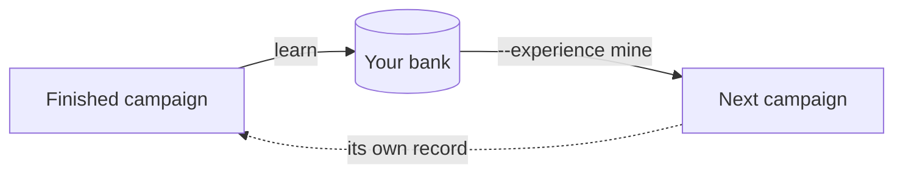

A campaign starts out knowing its [experience](/docs/experience): what was measured before, by you, by your team, or by others. What you measured yourself comes from your own runs. Every finished campaign is a record of what was tried, what it scored and what happened next, and `learn()` mines that record into **cards with receipts** in your bank, so the next campaign that loads the bank starts knowing what the last one measured.

```bash
kapso learn ./campaign
kapso learn ./campaign --harness ./harnesses/trading     # when the campaign's record names none
```

```python
lesson = kapso.learn(solution)
print(lesson.explain())
```



## Why measured experience

A page tells you what people have written down. It cannot tell you which of those approaches paid off on *your* task, at *your* scale, against *your* evaluation. The bank answers that: each card records a mechanism that paid or failed, the conditions it held under and the measurements behind it. A card is never a bare assertion. It carries a reliability state, a score and the evidence trail that earned them, and a score with no written rationale fails conformance (`reliability rationale missing — no naked scores`).

## What a card is

A card has a **body**, the fact itself, written to be read cold by an engineer who has never seen it, with a first heading that states the rule as a plain sentence (its *hero*, the one-liner the bank index shows); and a **reliability block**, what the evidence says about it.

| Card type | What it holds |
|-----------|---------------|
| `insight` | A mechanism that paid or failed, and the conditions under which it holds |
| `procedure` | A runnable recipe. Its code ships with the card, under `procedures/<name>/` |

A card carries its `scope`: `domain`, or the `harness:<name>` coordinate it was measured under (`harness:none` for a campaign that ran without one). The coordinate is read off the campaign's record, never invented. Its evidence entries say what a campaign did with the claim (confirmed, weakened, refined, refuted, exercised); a card converted from a curated source carries a `reported` entry instead, the score others reported with its author, licence and protocol, and is served as such, never as a measurement of yours.

A card sits in one of five reliability states, and only two reach a campaign:

| State | Serves? | Meaning |
|-------|---------|---------|
| `candidate` | yes | New, or a generalizing successor. Its claim is a prediction with its test attached |
| `active` | yes | Carrying evidence that supports it |
| `cold` | no | Kept, but not served |
| `retired` | no | Withdrawn. Frozen history under `retired/`, never modified again |
| `superseded` | no | Replaced by a successor that generalizes it; the two link both ways |

A card may declare that it `contradicts` another active card. When two such cards are served together, the pair is named to the reading agent rather than presented side by side as though they agreed.

## How a campaign becomes a card

One finished campaign moves through four stages. Each is bounded by a **frame** that does the mechanical work and validates the result; the judgment inside is done by agent sessions the frame launches, staged with the harness's learning module when the campaign ran under one.

| Stage | What happens |
|-------|--------------|
| Harvest | The campaign enters the trajectory store under a stable identity, with the experience it was served and the harness it ran under |
| Mine | The bundle is read into derived `mined/` views: strategy, operations, artifacts |
| Grade | The bank is graded against the campaign *before* it learns from it, so the score means something |
| Update | The update crew folds the result in as one reviewed commit, tagged `lr_<id>`, pushed to your share when the bank has one |

Grading before learning is the `exam` argument of [`learn()`](/docs/reference/kapso-api#learn); it defaults to `True`, and `False` is for development replays only. The stages, the graders and the learner's own development are on [Development mode](/docs/learn/development-mode).

## Where the bank lives

```bash
kapso experience add mine                                          # creates it; a first learn() does too
kapso experience share https://github.com/your-org/kapso-bank.git  # every learn() pushes there from then on
kapso experience list                                              # the head, the card count, where it shares to
```

The bank is a git repository at `learning.bank.local_path` (shipped as `~/.kapso/bank.git`): one bank per user, outside any project. Each card is a file, each lesson a tagged commit, so a campaign can be pinned to an exact bank state. Credentials stay with `git` and `gh`; Kapso never handles them. Sharing, reading a team's bank and the other sources are on [Your bank](/docs/experience/use) and [Share a bank](/docs/experience/share).

## How the next campaign reads it

A campaign reads a bank exactly when it loads it: `kapso build --experience mine`, the brief's `Experience` line, or `load_experience("mine")`. There is no serving switch; a build that loads nothing is served nothing, and the network is never on the campaign path: `mine` reads your bank's home, a bank you read is served from its clone in the store, and `kapso experience update` is the one network step.

Serving is an introduction, not an injection. At launch the frame clones each bank at a **pinned head** (a resume re-pins the same head even when the bank moved since), compiles an introduction with one line per source and its provenance, and stages three tools under `.kapso/serving/` in the campaign; the agent decides what to open.

| Tool | Returns | Call it when |
|------|---------|--------------|
| `bank_index()` | The whole eligible bank as one index page: name, one-liner, score, applies-when | Your next decision might have been faced before. Cheap |
| `bank_get_card(cards)` | Full card bodies; a procedure's code path with it | You want the advice |
| `bank_get_card_with_evidence(cards)` | The card plus its reliability block and evidence trail | Before you stake real budget on it |

The index is the whole eligible set in plain reliability order, with no `k` cap and no relevance cut. Two things are filtered, and the frame says which: **scope** (under a [harness](/docs/harnesses), `mine` serves the cards scoped `domain` or `harness:<name>`; a card outside is refused by name with the reason; `mine:all` serves every card you measured; a bank you read serves everything it holds) and **quarantine**, silently (decoys and the non-serving states). A card may carry a measurement offer, a *probe*, which rides card reads only, with a cost clause, under `learning.retriever.probe_budget` (shipped at `1`) and for `mine` alone.

Every read is logged. The pull log shows which cards the agent opened, at what depth and from which source, which is what grading scores serving from and what credits a cited lesson to the source it was read from.

## Related

<CardGroup cols={2}>
  <Card title="Development mode" icon="flask" href="/docs/learn/development-mode">
    The pipeline's stages, the graders, the bank's internals, the learner's own promotion
  </Card>
  <Card title="Your bank" icon="database" href="/docs/experience/use">
    Load it on a build; read what the campaign recorded
  </Card>
  <Card title="Experience reference" icon="book" href="/docs/reference/experience">
    The scope rule, the pull log, the gate's variables
  </Card>
  <Card title="learn() in the API" icon="code" href="/docs/reference/kapso-api#learn">
    The call, its arguments and the Lesson it returns
  </Card>
</CardGroup>

Kapso is an open-source framework by [Leeroo](https://leeroo.com) that builds software toward measurable goals through experiment campaigns. Source code: [github.com/Leeroo-AI/kapso](https://github.com/Leeroo-AI/kapso) · Install: `pip install leeroo-kapso` · Every page as plain text: [llms.txt](https://docs.leeroo.com/llms.txt).
