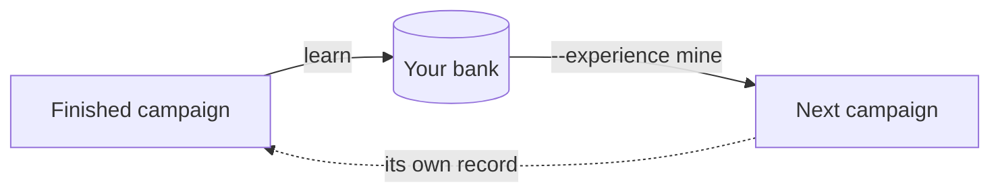

A campaign starts out knowing its [experience](/docs/experience): what was measured before, by you, by your team, or by others. Most of what others know arrives as pages, a repository or a question ingested into an index, or the hosted Leeroopedia gate. What you measured yourself arrives from your own work: every finished campaign is a record of what was tried, what it scored, and what happened next, and `learn()` mines that record into **evidence-priced cards** in your bank, so the next campaign that loads the bank starts knowing what the last one measured.

This section is about that bank: how it is filled, graded and served. Loading it, and the other sources beside it, is on [Use experience on a build](/docs/experience/use).



## Why measured experience

A page tells you what people have written down. It cannot tell you which of those approaches actually paid off on *your* task, at *your* scale, against *your* evaluation.

The bank answers that. Each card records a mechanism that paid or failed, the conditions it held under, and the measurements behind it. A card is never a bare assertion: it carries a reliability state, a score, and the evidence trail that earned them.

## What a lesson looks like

Cards come in two types.

| Type | What it holds |
|------|---------------|
| `insight` | A mechanism that paid or failed, and the conditions it holds under |
| `procedure` | A runnable harness. Its code ships with the card |

Every card carries a reliability block with a state, a score, and a written rationale. Scores are never naked: a card with a score and no rationale fails conformance. A card is scoped to the [harness](/docs/harnesses) it was measured under, or to the whole domain. See [The lesson bank](/docs/learning/bank).

## How a campaign becomes a lesson

```bash
kapso learn ./campaign
kapso learn ./campaign --harness ./harnesses/trading     # when the campaign's record names none
```

```python
lesson = kapso.learn(solution)
print(lesson.explain())
```

One finished campaign moves through four stages. Each stage is bounded by a **frame** that does the mechanical work and validates the result; the judgment inside is done by agent sessions the frame launches, staged with the harness's learning module when the campaign ran under one.

| Stage | What happens |
|-------|--------------|
| Harvest | The campaign enters the trajectory store under a stable identity, with the experience it was served and the harness it ran under |
| Mine | The bundle is read into derived `mined/` views: strategy, operations, artifacts |
| Grade | The bank is graded against the trajectory before it learns from it |
| Update | The update crew folds the result in as one reviewed, tagged commit, pushed to your share when the bank has one |

See [From campaign to banked lesson](/docs/learning/pipeline). The learning system's own tools (`kapso learn dev import|mine|grade|update|...`) run the stages one at a time, for people working on the learning system.

## Grading before learning

The order matters: grading always precedes learning, so the bank is scored on a trajectory it has not yet seen, which is what makes the score mean anything. The mechanics are on the [pipeline page](/docs/learning/pipeline).

That is the `exam` argument on [`learn()`](/docs/reference/kapso-api#learn), and it defaults to `True`. Setting it `False` is for development replays only.

## Serving

Banked lessons reach a campaign through three tools the reading agent calls itself. The frame introduces the bank and lists what is in it; it never selects cards on the agent's behalf. A campaign reads the bank exactly when it loads it:

```bash
kapso build --experience mine --brief kapso-brief.md --repo repo --output campaign --detach
```

See [Serving lessons to a campaign](/docs/learning/serving) and [Use experience on a build](/docs/experience/use).

## Where to next

<CardGroup cols={2}>
  <Card title="The lesson bank" icon="database" href="/docs/learning/bank">
    Cards, reliability states, and the bank repository
  </Card>
  <Card title="From campaign to lesson" icon="arrow-right-arrow-left" href="/docs/learning/pipeline">
    Harvest, mine, grade, update
  </Card>
  <Card title="Grading" icon="scale-balanced" href="/docs/learning/graders">
    How a bank is measured, and against what
  </Card>
  <Card title="Serving" icon="share-nodes" href="/docs/learning/serving">
    How lessons reach a running campaign
  </Card>
</CardGroup>

Related pages: [The lesson bank](/docs/learning/bank) · [From campaign to lesson](/docs/learning/pipeline) · [Grading](/docs/learning/graders) · [Serving](/docs/learning/serving) · [What experience is](/docs/experience)

Kapso is an open-source framework by [Leeroo](https://leeroo.com) that builds software toward measurable goals through experiment campaigns. Source code: [github.com/Leeroo-AI/kapso](https://github.com/Leeroo-AI/kapso) · Install: `pip install leeroo-kapso` · Every page as plain text: [llms.txt](https://docs.leeroo.com/llms.txt).
