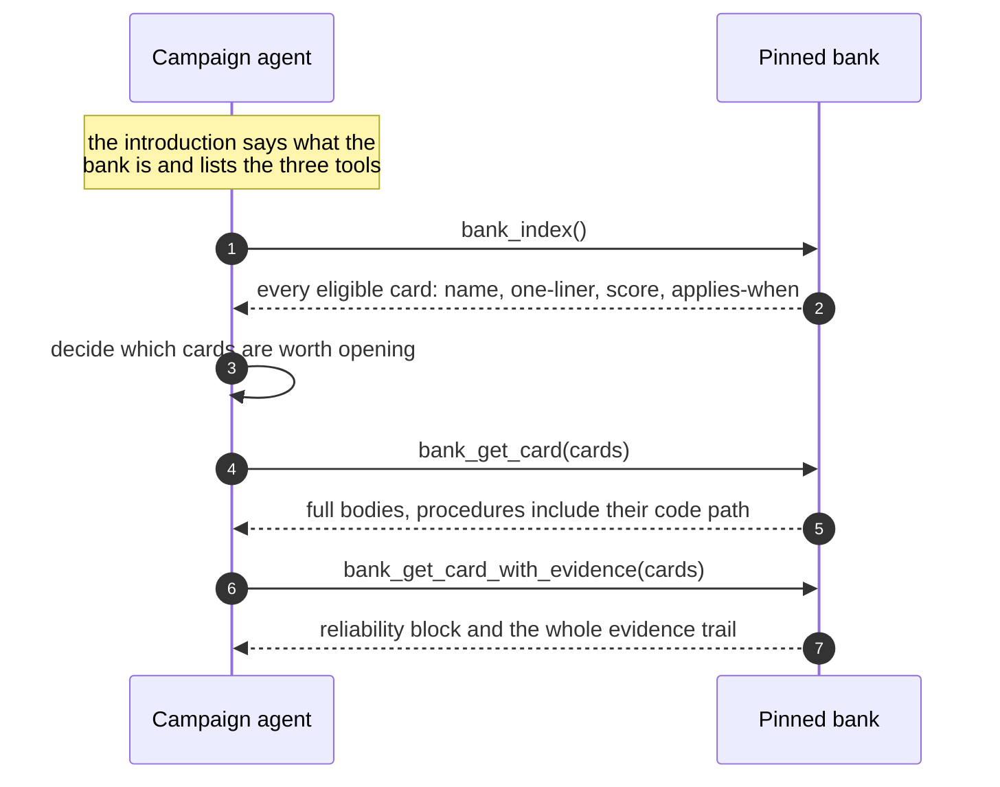

A campaign reads a bank exactly when the bank is loaded: `kapso build --experience mine`, the brief's `Experience` line, or `load_experience("mine")`. There is no serving switch; a build that loads nothing is served nothing. [Use experience on a build](/docs/experience/use) is the user's side; this page is what the frame does with a bank once it is loaded.

Serving is deliberately not retrieval-augmentation. The frame does not pick cards and paste them into a prompt. It introduces the bank, says what is in it, and hands the agent three tools. **Selection belongs to the reading agent.**

## What happens at launch

Before any session exists, the frame pins each bank and stages the tools:

- The bank is cloned at a **pinned head**, so the campaign is served one exact bank state for its whole life; a resume re-pins the same head even when the bank moved since.
- The introduction is compiled, one line per source with its provenance and the count served under the task's coordinate.
- The tool parameters are staged.

Everything lands in `.kapso/serving/` inside the campaign work directory: the clones, `intro.md`, the serving record, and the sessions' pull log. A harvested trajectory therefore carries the exact state it was served, which is what makes [grading](/docs/learning/graders) possible later.

<Note>
  The network is never on the campaign path. `mine` reads your bank's home at `learning.bank.local_path`; a bank you read is served from its clone in the store. A campaign does not fail because a remote was unreachable; `kapso experience update` is the one network step, and it never moves a running campaign's pin.
</Note>

## The three tools

| Tool | Returns | Call it when |
|------|---------|--------------|
| `bank_index()` | The whole eligible bank as one index page | Your next decision might have been faced before. Cheap |
| `bank_get_card(cards)` | Full card bodies | You want the actual advice |
| `bank_get_card_with_evidence(cards)` | The card plus reliability and evidence | Before you stake real budget on it |

The index is the **whole eligible set**, not a ranked subset. There is no `k` cap, no ranking cut and no relevance discount; rank is plain reliability order, and judging relevance is the reader's job. When two loaded banks hold a card of one name, each row says its source and `bank_get_card(cards, source=)` opens the one asked for.

## What the frame does filter

Two things, and it says which.

**Scope.** A card learned under a [harness](/docs/harnesses) is scoped to it. Under a harness, `mine` lists and opens the cards scoped `domain` or `harness:<name>`; a card outside is refused by name with the reason, and `mine:all` serves every card you measured. A bank you read serves everything it holds.

**Quarantine, silently.** Cards in the decoy registry and cards in non-serving states (`cold`, `retired`, `superseded`) never appear on either surface.

That is the entire filter. Everything else the bank knows, the agent can see.

## Contradictions are named

When a returned set contains two cards that declare they contradict each other, the pair is named to the agent rather than presented side by side as if they agreed. Disagreement in the bank is surfaced as disagreement.

## Probe offers

A card may carry an optional measurement offer. Probes ride **card reads only**, never the index, never the introduction, and they arrive with an explicit cost clause:

> This is an optional measurement offer, not your default gate: adopt its protocol only if it is affordable at this dataset's scale, and say so explicitly. An ignored probe stays queued.

That wording exists because of a real failure: a probe protocol silently adopted as the default gate taxed every experiment on a large dataset. The budget is `learning.retriever.probe_budget`, shipped at `1`, and offers ride `mine` alone: a bank you read is not yours to measure for.

## Why an introduction rather than an injection

Injecting selected cards makes the frame guess what matters before the agent has seen the problem. Handing over an index and three tools moves that judgment to the point where the context exists.

It also leaves a record. The pull log shows which cards the agent actually opened, at what depth and from which source, which is the evidence the `SERVED-USED`, `UPTAKE-FAIL` and `SERVE-MISS` markers are scored from during [grading](/docs/learning/graders#the-two-layers-of-a-report), and what credits a lesson's citation to the source it was read from.

## Related

<CardGroup cols={2}>
  <Card title="Use experience on a build" icon="play" href="/docs/experience/use">
    Load the bank; read what the campaign recorded
  </Card>
  <Card title="The lesson bank" icon="database" href="/docs/learning/bank">
    What is on a card
  </Card>
  <Card title="Grading" icon="scale-balanced" href="/docs/learning/graders">
    How serving is measured
  </Card>
  <Card title="Experience reference" icon="book" href="/docs/reference/experience">
    The scope rule, the pull log, the gate's variables
  </Card>
</CardGroup>

Related pages: [Use experience on a build](/docs/experience/use) · [The lesson bank](/docs/learning/bank) · [Grading](/docs/learning/graders) · [Overview](/docs/learning/overview)

Kapso is an open-source framework by [Leeroo](https://leeroo.com) that builds software toward measurable goals through experiment campaigns. Source code: [github.com/Leeroo-AI/kapso](https://github.com/Leeroo-AI/kapso) · Install: `pip install leeroo-kapso` · Every page as plain text: [llms.txt](https://docs.leeroo.com/llms.txt).
