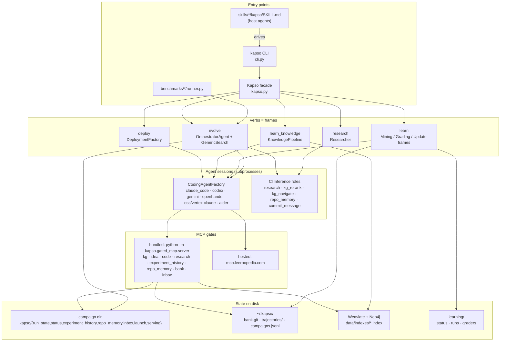

# Kapso plugin: a mental model of the modules and their seams

*2026-10-12, branch `kapso-plugin`. The working document for the coding-agent
plugin: what Kapso is made of, how the pieces connect, where a plugin can plug
in, and the first proposal to iterate on. Companion to the August research
brief (`coding-agent-plugin-brief.md`), which holds the market reasoning; this
one holds the engineering. Line numbers are as of v0.7.5.*

## 0. The model in one paragraph

Kapso is one facade class, `Kapso` (`src/kapso/kapso.py`), over five verbs:
`evolve`, `learn`, `learn_knowledge`, `research`, `deploy`. Every verb has the
same shape: a **frame** written in Python does the mechanics (stage inputs,
spawn, verify, record), and the judgment inside it is done by **agent
sessions**, which are coding-agent CLI subprocesses (`claude -p`, `codex
exec`) driven through one adapter interface. There is no direct model API for
generation; the only SDK call left is embeddings. Sessions reach Kapso's
knowledge through **MCP gates** (one bundled stdio server plus the hosted
Leeroopedia server). Everything a verb knows or produces is **a file on disk**:
a campaign directory with a `.kapso/` folder, `~/.kapso/` for the user's
memories, `learning/` for crew runs. One YAML file holds every knob; `.env` in
the launch directory holds every secret. The CLI (`src/kapso/cli.py`) is a thin
wrapper over the facade, and the three `SKILL.md` files under `skills/` are the
operating procedure that teaches a host agent to drive that CLI.

A plugin therefore has two jobs. Outward, it is a host-native wrapper over the
CLI and the status files, so the engineer never leaves the agent to run or
follow Kapso. Inward, it hands the host session the same MCP gates that
Kapso's own sessions get, so the session can consult the organisation's
knowledge and experience mid-task.

## 1. Layer map



The arrows are the only couplings that matter for a plugin: the facade is the
sole owner of a verb's lifecycle, sessions are opaque subprocesses, gates are
the only way knowledge reaches a session, and every store is a plain path.

## 2. Module map

| Package | Role | Entry points worth knowing | Depends on |
|---|---|---|---|
| `kapso.py` (1915 lines) | The facade. Owns every verb's lifecycle, preflight, serving, launch record, status file, harvest | `Kapso(config_path, kg_index, bank)`; `evolve` 1150; `learn` 779; `learn_knowledge` 471; `research` 438; `deploy` 1691; `index_kg` 313; `memory` 709; `status` 752 (static); `inbox` 1571, `inbox_ideas` 1581, `reply` 1594 (static/class) | everything below |
| `cli.py` (1207) | Nine commands, thirteen subcommands, each a few lines over the facade | `cmd_evolve` 84 (blocking), `cmd_inbox` 223, `cmd_inbox_reply` 249, `cmd_research` 282, `cmd_learn` 363, `cmd_deploy` 551, `cmd_index_kg` 607, `cmd_bank` 636, `cmd_doctor` 660, `cmd_watch` 711 (pure reader) | facade |
| `config.yaml` + `core/config.py` | The one config. `load_mode_config` deep-merges `modes[<mode>]` over the packaged `defaults:`; a user file's own `defaults:` is ignored | `load_config`, `load_mode_config`, `load_platform_defaults`, `load_deployment_defaults` | none |
| `core/preflight.py` (1120) | Requirements derived from the active config per verb; static tier (binaries, logins, ports, remotes) and live tier (one-token probes). Same rows as `kapso doctor` | `run_preflight(verb, config, ...)`, `requirements_for`, `render`, `VERBS` | config, gates, bank remote |
| `core/cli_inference.py`, `core/llm.py` | Completions as read-only CLI sessions by **role** (`inference:` block); embeddings via SDK | `CliInference(role=...)`, `resolve_inference_config` | coding agents |
| `execution/orchestrator.py` (1861) | The campaign loop: budget, context, one strategy iteration per loop, stop, checkpoint, status, inbox pause, candidate admission (cost, fidelity, evaluator) | `OrchestratorAgent(...)`, `solve(experiment_max_iter, time_budget_minutes, cost_budget, finalization_reserve_minutes, on_status) -> SolveResult` | strategy, memories, budget, checkpoint, observability, inbox |
| `execution/search_strategies/generic/` | The one shipped strategy. `strategy.py` 1788: parent selection, ideation, parallel lanes, implementation, judge, lineage, `dump_state/load_state`. `ideation.py` (ensembles, selector), `lens_planning.py`, `implementation.py` (`run_implementation`, inbox follow-ups), `feedback_flow.py` + `feedback_generator/` (the judge), `registered_evaluation.py`, `expansion_lanes.py`, `prompts/` (every session prompt and the per-gate guidance under `prompts/gates/`) | `GenericSearch.run(context, budget_progress)` 487; `_select_parent` 1491 | workspace, coding agents, gates |
| `execution/experiment_workspace/` | The campaign git repo (`output_path`): `main` plus `generic_exp_N`; seeds from `initial_repo`; copies `eval_dir` to `kapso_evaluation/` and `data_dir` to `kapso_datasets/`. `ExperimentSession` clones a branch into `/tmp/kapso_candidate_*`, runs the agent there, commits, pushes the branch back, deletes the folder | `ExperimentWorkspace`, `ExperimentSession` | git |
| `execution/coding_agents/` | The session boundary. `agents.yaml` is the registry; `base.py` the interface (`initialize`, `generate_code(prompt, debug_mode, timeout_seconds) -> CodingResult`, `resume`, `cleanup`, `get_cumulative_cost`, `supports_native_git`); `factory.py` builds configs and adapters | `claude_code_agent._build_command` 1168; `codex_agent.mcp_config_overrides` 48 | the CLIs |
| `gated_mcp/` | `presets.py`: the `GATES` registry (tools, required env, guidance prompt per phase, hosted URL), `resolve_gates`, `get_mcp_config` 479 (returns a Claude-shaped `mcpServers` dict plus `allowed_tools`), `user_setup_gaps`. `server.py`: the bundled stdio server, configured by `MCP_ENABLED_GATES` and per-gate env. `gates/*.py`: one `ToolGate` class per gate | `get_mcp_config(gates, kg_index_path, experiment_history_path, repo_root, bank_serving, inbox)` | stores |
| `execution/memories/` | `experiment_memory/store.py`: `.kapso/experiment_history.json`, top/recent/similar (embeddings optional). `repo_memory/`: `.kapso/repo_memory.json`, the evidence-backed book, bootstrapped and updated through the `repo_memory` inference role | `ExperimentHistoryStore`, `RepoMemoryManager` | CliInference |
| `execution/inbox.py` (529) | `.kapso/inbox.jsonl` (events `requested`/`replied`/`continued`), the launch record `.kapso/launch.json`, the registry `~/.kapso/campaigns.jsonl`; `resume_arguments`, `launch_mismatches` | `load_requests`, `record_reply`, `read_launch_record`, `register_campaign` | none |
| `execution/run_checkpoint.py` | `.kapso/run_state.json`, schema 3, atomic replace, fingerprints (goal, config, strategy params, eval_dir, cost policy) | `RunCheckpointStore`, `RunCheckpoint` | none |
| `execution/observability.py` (643) | One status layer for evolve, learn and learn_knowledge: atomic `status.json`, states `starting/running/done/failed`, phases, a ten-line recent ring, heartbeat, pid; the reader `OperationStatusView` (DEAD when the pid is gone, STALLED after three missed heartbeats, `WAITING ON YOU` rows, `--tree`) | `EvolveStatus`, `LessonStatus`, `KnowledgeStatus`, `OperationStatusView(path).explain(tree=)` | none |
| `execution/budget.py`, `cost_estimator.py`, `fidelity.py`, `evaluation_integrity.py`, `evaluation_maintainer/`, `iteration_evaluator.py`, `evaluation_archive*.py` | Budget ledger and dials; platform-cost admission; fidelity grants; `eval_dir` fingerprinting and tamper rejection; registered evaluators; caller-owned external evaluation | | orchestrator |
| `learning/` | The experience memory. `trajectory_store.py` (bundles under `~/.kapso/trajectories/<task>/<stamp>_<lane>/`, manifest written last, strict contract: `campaign_meta.json`, `final_report.json`, `campaign.log`, `features_history.md`, `lens_plan_history.jsonl`, `experiment_history.json`); `harvest.py` (the evolve-to-store bridge); `mining.py` (one Claude lead session, `mined/` views); `graders/` (report writer on Codex, verifier on Claude, assessor on Codex; corridor arithmetic frame-side); `update_frame.py` (Claude lead, Codex workers, critic; validates the diff; commits `lr_<id>`); `bank.py` (card model, five states, two servable); `retriever.py` (`compile_intro`, `render_index`, `render_cards`, probe queue, pull log); `serving_launch.py` (pin the bank into `.kapso/serving/`, env for the bank gate); `bank_remote.py`; `codify_*`, `gcp_ephemeral.py`, `develop.py`, `ab.py`, `behavior.py` (the learner-development regime) | `Kapso.learn` chain: import → mine → exam → lesson → push | coding agents, git |
| `knowledge_base/` | The imported memory. `learners/` (`KnowledgePipeline`; ingestors: `repo_ingestor/` multi-phase Claude sessions, `research_ingestor/`, `experiment_ingestor.py`; `merger/` one Claude session with the kg tools); `search/` (`kg_graph_search.py` 2160 over Weaviate + Neo4j with OpenAI or Vertex embeddings; `kg_llm_navigation_search.py`; `workflow_search.py`; `.index` files are small JSON references with `backend_refs`); `types.py` (`Source.*`, `WikiPage`, `ResearchFindings`) | `index_kg`, `learn_knowledge` | Weaviate, Neo4j, embeddings |
| `researcher/` | One read-only Codex session with web search; returns typed ideas, implementations or a report | `Researcher`, `ResearchFindings` | CliInference `research` role |
| `deployment/` | Selector session (AUTO) → adapter session (rewrites a copy as `<path>_adapted_<strategy>`) → validator → runner; five strategy plugins, each a directory with `runner.py`, `config.yaml` (`requires`), selector and adapter instructions | `DeploymentFactory.create`, `Software.run/stop/start/is_healthy/logs` | docker/modal/bentoml/langgraph SDKs |
| `environment/handlers/` | `ProblemHandler` (problem context, `maximize_scoring`, `honor_agent_stop`, optional `final_evaluate`); `GenericProblemHandler` for evolve; benchmark handlers under `benchmarks/` | | |
| `skills/` | `claude-code/`, `codex/` (+ `agents/openai.yaml`), `opencode/`: one `SKILL.md` each, identical except the launch line (`nohup … &` vs `setsid -f`). Tested eval-first; record in `coding-agent-skill-findings.md` | | the CLI |

## 3. The verbs as sequences

### 3.1 evolve

```mermaid
sequenceDiagram
    autonumber
    participant U as Engineer / host agent
    participant F as Kapso.evolve
    participant O as Orchestrator
    participant S as GenericSearch
    participant A as CLI sessions
    participant D as campaign dir

    U->>F: goal, initial_repo, eval_dir, data_dir, budgets
    F->>F: preflight (static tier), serving plan
    F->>O: construct; workspace seeded from initial_repo
    F->>D: .kapso/launch.json, ~/.kapso/campaigns.jsonl
    loop until stop
        O->>O: budget progress = max(time, iterations, cost)
        O->>S: run(problem + previous feedback)
        S->>S: select parent (best valid, else latest committed, else main)
        S->>A: ideation session (read-only worktree, ideation gates)
        S->>A: implementation session on branch generic_exp_N (implementation + inbox gates)
        A-->>S: XML tags (summary, eval path, output, score, difficulties) or request_from_user
        S->>A: judge session (FeedbackGenerator)
        A-->>S: stop, evaluation_valid, score, feedback
        S->>D: experiment_history.json, repo_memory.json, branch pushed
        O->>D: run_state.json (atomic), status.json (heartbeat 60s)
    end
    O-->>F: SolveResult (stopped_reason, best, requests)
    F->>D: checkout best branch
    F-->>U: SolutionResult
```

Facts a plugin leans on:

- `evolve()` **blocks** for the whole campaign. The skill launches it detached
  (`nohup … &`, or `setsid -f` under Codex) and hands the engineer `kapso
  watch --follow`. The status file appears only after the seed copy and the
  repo-memory bootstrap, usually minutes in; `kapso watch --follow` before
  that prints a traceback instead of a one-line wait (lab finding, unfixed).
- Stop reasons: `goal_achieved`, `max_iterations`, `budget_exhausted`,
  `cost_budget_exhausted`, `legacy_stop`, `waiting_for_user`. A pause is exit
  code 0 and `WAITING ON YOU` in the summary block.
- Resume is strict: `kapso evolve --output <dir> --resume` reads the goal from
  the checkpoint and every flag from the launch record; a changed mode, agent,
  `eval_dir`, config or index is refused by name (`kapso.py` 1230).
- Serving: when `learning.serving.enabled` and a bank exists, the bank is
  pinned into `<dir>/.kapso/serving/bank`, an intro is appended to the problem
  context, and the `bank` gate is mounted; the task family defaults to the mode
  name unless `serving_scope` is passed (`kapso.py` 1340).
- Every gate call is tallied per node into `phase_telemetry`; the summary and
  `watch --tree` show "Knowledge consulted" and Leeroopedia credits.

### 3.2 learn

`Kapso.learn(source)` with a `SolutionResult`, a campaign path, or a
trajectory id: harvest the campaign into the store (strict contract, manifest
last) → mining frame (one Claude lead, `mined/` views, quote re-grep) → exam
(hindcast of the pinned pre-lesson bank head) → update crew (one reviewed
commit tagged `lr_<id>`) → push when the bank has an origin. Status at
`learning/status/learn-<stamp>.json`, phases `harvest, mine, exam, lesson,
push`. Hours, both CLIs, real quota. The bank is created on first use at
`~/.kapso/bank.git`; `kapso bank connect|create` attaches a remote.

### 3.3 learn_knowledge, index_kg, research

`research(objective, mode, depth)` is one Codex session with web search,
minutes, no infrastructure. `learn_knowledge(*sources, wiki_dir)` runs
ingestors (multi-phase Claude sessions holding only file tools) then the
merger (one Claude session with the kg tools) into Weaviate + Neo4j; hours;
stages under `<wiki_dir>/_staging/`; resumable per phase. `index_kg` writes a
`.index` reference that `Kapso(kg_index=...)` loads, which mounts the `kg`,
`idea` and `code` gates into campaigns.

### 3.4 deploy

`deploy(solution, strategy)` runs the selector session (AUTO only), then the
adapter session on a copy, validates (compiles, required files, import for
LOCAL), and returns a `Software`. Minutes, foreground. The CLI prints the
result; calling the deployed software is Python-only.

## 4. The session boundary

How a Kapso session is spawned, which is also how a plugin's host session
differs from one.

| | Claude Code adapter | Codex adapter |
|---|---|---|
| Command | `claude -p --dangerously-skip-permissions --output-format stream-json --verbose --model M --effort E --allowedTools … --tools … --mcp-config <json> --strict-mcp-config --append-system-prompt …` (`claude_code_agent.py` 1168) | `codex exec --sandbox S -m M -c model_reasoning_effort=E --json [--search] -c mcp_servers.<name>.*` (`codex_agent.py` 203) |
| Session identity | `--session-id <uuid>` minted at launch; continued with `--resume <id>` | `--json` captures the thread id; continued with `codex exec resume <id> -` |
| Prompt | stdin; the implementation prompt carries the problem, the chosen idea, the repo-memory brief and the knowledge-tools block of exactly the gates mounted | same |
| Ends with | the XML result tags, or a `request_from_user` call (the adapter grants `stop_grace_seconds`, then ends the session) | same |
| Credentials | `auth_mode` hygiene: `oauth` strips `ANTHROPIC_API_KEY`; `api_key` strips the OAuth token; `bedrock` strips both | `OPENAI_API_KEY` stripped; `~/.codex/auth.json` or `CODEX_API_KEY` |
| Cost | from the stream-json result event | none reported |

A host session that a plugin lives in is the mirror image: the engineer's own
`claude` or `codex`, with its own login and permission mode, and the plugin
can only add MCP servers, skills, commands and hooks to it. The MCP config
shape Kapso already emits (`get_mcp_config`) is the shape a plugin's
`.mcp.json` needs, with one difference: Kapso names `sys.executable`, a plugin
must name a command that exists on the engineer's PATH.

## 5. State on disk

```text
<campaign dir>  (--output; a git repo)
├── main, generic_exp_0..N            one branch per experiment; main holds the seed
├── kapso_evaluation/                 provided (fingerprinted) or agent-built evaluator
├── kapso_datasets/                   copied data
└── .kapso/
    ├── run_state.json                checkpoint, schema 3; status running|completed; last_stop
    ├── status.json                   state, phase, recent ring, budget bars, best, pid, heartbeat
    ├── experiment_history.json       every node; the experiment_history gate reads it
    ├── repo_memory.json              the book (per branch)
    ├── inbox.jsonl                   requested / replied / continued events
    ├── launch.json                   the launch's arguments; resume and reply read it
    ├── serving/                      bank/ (pinned clone), serving-record.yaml, serving-pull.jsonl
    ├── lens_plan_history.jsonl, sessions/, ideation/   harvested into the trajectory
    └── (evaluation archive)

~/.kapso/
├── bank.git                          the lesson bank home (bare); origin = share remote
├── trajectories/<task>/<stamp>_<lane>/   bundles + mined/ views
└── campaigns.jsonl                   one line per launch: ts, path, goal (test launches included)

<cwd of the launch>
├── .env                              every secret; found with find_dotenv(usecwd=True)
├── learning/{status,runs,graders,imports,develop,behavior}/   learn's run dirs (gitignored)
└── data/{wikis,indexes}/             learn_knowledge output, .index files

Host transcripts: ~/.claude/projects/… and ~/.codex/sessions, keyed by the session id in the checkpoint node
```

## 6. Control and observation surfaces a plugin can use today

| Need | Surface | Shape | Gap |
|---|---|---|---|
| Is the install ready? | `kapso doctor [verb] [--models] [--config]` | text rows `[OK ]/[FAIL]/[-- ]`, exit code | no `--json` |
| Start a campaign | `kapso evolve …` (blocking) | prints `status: <path>` at launch | no detached mode; status file lags minutes |
| Follow a campaign | `.kapso/status.json`; `Kapso.status(path)`; `kapso watch [--json|--follow|--tree]` | state, phase, recent, budget, best, pid, heartbeat; DEAD/STALLED derived | schema undocumented; registry lists dead and test campaigns |
| Answer a pause | `Kapso.inbox(dir)`, `Kapso.reply(dir, id, note)`; `kapso inbox [reply]` | requests with key/hit/tried/fix/next; reply resumes in the foreground; refuses while the pid is live; refuses credential-shaped notes | reply must be spawned detached from a plugin |
| Resume a dead campaign | `kapso evolve --output <dir> --resume` | reads checkpoint + launch record | pass `--config` when the launch had one |
| Knowledge tools in a session | `get_mcp_config(gates=…)`; `python -m kapso.gated_mcp.server` with `MCP_ENABLED_GATES` | Claude-shaped `mcpServers` + allowed tools; per-gate guidance text | no console entry on PATH; bank gate needs a staged checkout and task coords; repo_memory needs `.kapso/repo_memory.json` in the repo |
| Session-start brief | `compile_intro(bank, task_coords, head)`, `render_index`, `Kapso.memory` | ~30-line intro + index | no "external session" serving record |
| Learn | `Kapso.learn(dir)`; `learning/status/learn-*.json` | hours | host sessions have no trajectory (needs the P3 translator) |
| Research / import | `kapso research -o findings.json`; `learn_knowledge`; `index_kg` | minutes / hours | infra for the KG |
| Deploy | `kapso deploy --solution-path --strategy` | minutes, foreground | running the software is Python-only |

## 7. What the hosts give us (verified 2026-10-12 on this box)

- **Claude Code 2.1.296.** A plugin is a folder with `.claude-plugin/plugin.json`
  (`name`, `version`, `description`, `author`, `keywords`, `skills`,
  `mcpServers` → `.mcp.json`, `hooks` → `hooks/hooks.json`, `commands/`,
  `agents/`, `userConfig`). A repository becomes a marketplace with
  `.claude-plugin/marketplace.json`; install is `claude plugin marketplace add
  <owner>/<repo>` then `/plugin install kapso@<marketplace>`; development is
  `claude --plugin-dir <folder>` with hot reload. Two hook systems: the classic
  JSON hooks (`SessionStart`, `UserPromptSubmit`, `PreToolUse`, `PostToolUse`,
  `Stop`, `SessionEnd`, `Notification`, `SubagentStop`, `PreCompact`) and the
  **hooks module** (`hooks/hooks.json` → `register(on, options)` in TSX): events
  such as `session.start`, `prompt.submit`, `prompt.compose`, `tool.call`,
  `command.run`, `turn.step`, `ui.render`; engine nouns `$.ui` (a pane, a band
  above the prompt, the status line, toasts, notices), `$.command.register`,
  `$.tool.register`, `$.agent.register/spawn`, `$.process.run/spawn`,
  `$.clock.every`, `$.fs`, `$.model`, `$.state/$.store`. `claude plugin
  validate|test` check a mod. Reference: the `plugin-authoring` skill and its
  21k-line `claude-code.d.ts`.
- **Codex 0.153.4.** Skills in `.agents/skills/<name>/SKILL.md` with
  `agents/openai.yaml` (display name, default prompt, implicit-invocation
  policy, MCP dependencies); the parser keeps only name, description and the
  sidecar. MCP via `codex mcp add` or `config.toml` `mcp_servers.<name>`.
  Native plugins: `.codex-plugin/plugin.json` (`name`, `version`, `description`,
  `skills: "./skills/"`, `mcpServers: "./.mcp.json"`, an `interface` block with
  display name, capabilities and default prompts); `codex plugin marketplace
  add <local|git>`, `codex plugin add kapso@<marketplace>`. No UI hooks. Its
  shell ends a plain `nohup … &` child when the call returns.
- **Cursor.** `.cursor-plugin/plugin.json` (`name`, `displayName`, `skills`,
  `mcpServers`), `.cursor/mcp.json`, `.cursor/skills/`.
- **OpenCode.** Reads `.opencode/skills`, `.claude/skills` and
  `.agents/skills`; `opencode mcp`; JS/TS plugins via `opencode plugin`;
  `permission.skill` allow/deny.
- **The shared shape.** The Canva plugin installed on this box ships one
  `skills/` tree and one `.mcp.json` beside three manifests
  (`.claude-plugin/`, `.codex-plugin/`, `.cursor-plugin/`). That is the layout
  the August brief predicted and the one to copy.

## 8. The seams, numbered

Each seam names what exists, what is missing, and the size of the gap.

- **S0 Install and configuration.** The plugin must find `kapso` (and its
  interpreter for the MCP server), the user's config file (`--config`), and
  `.env` in the project. Exists: `kapso doctor`, `DEFAULT_CONFIG_PATH`.
  Missing: a `kapso-mcp` console script; a machine-readable doctor. Small.
- **S1 Launch.** Exists: the CLI and the skill's detached-launch recipe.
  Missing: a detached mode that returns the status path and pid at once, so a
  host UI can start tracking without polling a log. Small (facade + CLI).
- **S2 Follow.** Exists: `status.json` and `OperationStatusView`. Missing: a
  documented schema and a liveness-filtered registry so "every campaign on
  this machine" is a cheap read. Small.
- **S3 Inbox.** Exists: the whole pause/reply loop. Missing: nothing in Kapso;
  the plugin must run the reply detached and must never carry a secret through
  the model. Small, UI-side.
- **S4 Knowledge tools in the host session.** Exists: the gate registry and
  server, the guidance prompts, the hosted Leeroopedia gate. Missing: a PATH
  entry point; an "external session" mode for the `bank` gate (task coords and
  pull log without a campaign dir); a decision on which gates ride in a host
  session by default given the context budget. Medium.
- **S5 Session-start brief.** Exists: `compile_intro` and `render_index`.
  Missing: the external-session serving record so a later `learn` can score
  uptake. Small to medium.
- **S6 Delegation as a tool.** Exists: `moltbook_bot/server.py` runs
  `evolve` in a background task with a poll endpoint. Missing: the same as MCP
  tools (`kapso_evolve_start`, `kapso_status`) so the host agent, not only the
  engineer, can delegate. Medium; sequence after S1 and S2.
- **S7 Learn from host sessions.** Exists: the store contract and the crews.
  Missing: the transcript-to-trajectory translator and a scoring story (tests,
  CI, review outcomes). Large; the August brief's P3.
- **S8 Distribution.** Exists: the repository, the docs MCP server, the
  skills. Missing: the manifests, a marketplace file, submissions. Small.

## 9. Proposal v0 (to iterate)

Principles, from the brief and the skill-lab findings: own the moment, not a
category; one-command install; background by default with a clean handoff;
never block the host session; secrets never cross the model; the skill carries
the facts so no session greps the package; a tiny always-on footprint with
everything else behind tools; truthful states (a pause is not a failure);
evidence on screen (scores, credits, bank head).

One source tree, `plugin/` in this repository, three thin manifests:

```text
plugin/
├── .claude-plugin/plugin.json    name kapso; skills, mcpServers, hooks, commands
├── .codex-plugin/plugin.json     skills, mcpServers, interface
├── .cursor-plugin/plugin.json    skills, mcpServers
├── .mcp.json                     kapso-mcp (stdio) + leeroopedia (http, when the key is set)
├── skills/kapso/SKILL.md         the operating procedure (today's skill, host-neutral launch line)
├── commands/                     /kapso:doctor evolve watch inbox resume learn research deploy bank
└── hooks/                        Claude Code only: hooks.json + register.tsx
```

Layers, in delivery order:

1. **Manifests + skill + MCP** (S0, S4, S8). `kapso-mcp` console script;
   default gates for a host session: `research`, `repo_memory`, `bank`, plus
   `experiment_history` inside a campaign directory and `kg` when an index is
   configured; Leeroopedia as a pass-through entry when `LEEROOPEDIA_API_KEY`
   is present. Marketplace file at the repo root so `Leeroo-AI/kapso` is the
   marketplace. Same install line in the README for Claude Code and Codex.
2. **Commands** (S1, S3). `/kapso:evolve <goal>` launches detached and hands
   back `watch`; `/kapso:inbox` lists and replies; `/kapso:resume`,
   `/kapso:learn`, `/kapso:research`, `/kapso:deploy`, `/kapso:doctor`. In
   Codex the same procedures ride the skill's default prompts.
3. **Live UI in Claude Code** (S2, S3). A status-line entry for the campaign
   the session launched or the directory is inside ("kapso · churn-campaign ·
   it 3/10 · best 0.87 · 42 min left"); `/kapso:watch` opens a pane that
   re-renders `status.json` and the tree at the heartbeat; a band above the
   prompt when a registered campaign is `WAITING ON YOU`, with the request
   rows and a reply action that runs detached; a toast on `COMPLETED`, `DEAD`
   or `STALLED`.
4. **Session-start brief** (S5). When a bank exists, `prompt.compose` appends
   the ~30-line intro and the bank tools are mounted; otherwise nothing is
   injected. Off switch in `userConfig`.
5. **Delegation tools** (S6). `kapso_evolve_start` / `kapso_status` MCP tools
   over a detached launch, so the agent can hand off an optimisation-shaped
   task on its own and report back with a scored result.
6. **Capture** (S7). `SessionEnd` enqueues the host session for a light
   mining tier. Out of scope for the first release.

## 10. Questions to settle before building

1. Hosts and order: Claude Code first with the full UI, Codex and Cursor
   through manifests, OpenCode through the skill folders it already reads?
2. Packaging: `plugin/` inside this repository with the repo as marketplace,
   or a separate `kapso-plugin` repository? Version coupling: the skill states
   facts for 0.7.x; does the plugin version track the package version?
3. Install contract: does the plugin assume `pip install leeroo-kapso` plus two
   logged-in CLIs, or does a `kapso setup` do that? Where does `kapso-mcp` get
   its interpreter on a machine with several Pythons?
4. Default gates in a host session, against the context budget: research,
   repo_memory, bank by default; experiment_history only inside a campaign;
   kg only with an index; Leeroopedia as our entry or left to its own plugin?
5. Repo memory for an arbitrary repository: bootstrap `.kapso/repo_memory.json`
   on first use (a multi-minute inference session) or skip the gate until a
   campaign has built one?
6. Bank serving for a host session: which task family, where the pull log
   lives, and whether the brief is injected automatically or only on request.
7. The launch UX: command-driven (the engineer launches) first, agent-driven
   (the agent delegates through tools) later, or both from the start?
8. The one skill body must serve Claude Code and Codex from one folder: a
   host-neutral launch line (a small `kapso launch` helper that detaches
   correctly on both) or two skills?
9. Configuration surface: `userConfig` in the plugin (config path, default
   budgets, brief on/off) versus everything from the Kapso config file.
10. Naming: the plugin namespace `kapso` gives `/kapso:evolve`; the skill is
    already invocable as `/kapso`. Keep both, or fold the skill under the
    commands?
